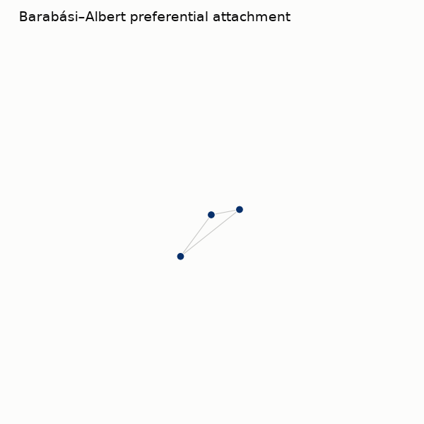

# dynamic-networks

A catalog of network-dynamics rules, each written as a process-bigraph reaction.
Add a node, rewire an edge, let a species diffuse — every rule is one `_add` /
`_remove` reaction on a shared `NetworkDynamicsProcess`, so the rules are directly
comparable and adding one is a single function. Fifteen studies run the rules,
show the network changing, and measure the structure that emerges.

**[Open the interactive dashboard](https://vivarium-collective.github.io/viva-dynamic-networks/dashboard/)**
to browse every study, composite, and result in the browser — or run it locally
(below).

## What's inside

Fifteen studies in three groups:

- **Dynamics *of* the network** — topology changes: Erdős–Rényi random growth,
  Barabási–Albert preferential attachment, Watts–Strogatz small-world rewiring,
  Bianconi–Barabási fitness, duplication–divergence, forest-fire densification,
  adaptive coevolution, and activity-driven temporal networks.
- **Dynamics *on* the network** — SBML at the nodes: a COPASI Repressilator runs
  in every node (via [viva-copasi](https://github.com/vivarium-collective/viva-copasi))
  and proteins diffuse along the edges. With coupling the oscillators synchronise;
  the uncoupled control stays out of phase.
- **Both at once** — co-evolution: topology and node state change together
  (growing and rewiring repressilator networks), plus proposed quorum-sensing and
  model-agnostic (Brusselator) studies.

Each rule's primary papers live in the workbench **Resources** tab
(`viva_dynamic_networks/data/vg_data/structured_resources.yaml`), and every study
cites them.

### Composites

<!-- BEGIN:composites -->
<!-- generated by `vivarium-workbench gen-readme` — edit the source, not this table -->

| Composite | What it is |
|---|---|
| `activity_driven` | Perra activity-driven temporal network: each step all edges reset, then each node fires with probability ∝ its activity and links to m random others — a blinking contact sequence. |
| `adaptive_rewire` | Gross–Blasius coevolution: opinions spread voter-style while, with rate w, nodes cut ties to differing neighbours and reconnect to like-minded ones — topology and state co-adapt. |
| `duplication_divergence` | Duplication–divergence: a new node copies a random node's edges, retaining each with probability q (optional parent link with probability p) — reproduces protein-network topology. |
| `erdos_renyi` | Random growth (Erdős–Rényi): a node arrives each step and links to each existing node with probability p. |
| `fitness_attachment` | Bianconi–Barabási: preferential attachment weighted by an intrinsic per-node fitness η — a fit latecomer can overtake older hubs. |
| `forest_fire` | Forest-fire growth: a new node burns recursively outward from a random ambassador — densification and shrinking diameter. |
| `growing_repressilator_network` | Dynamics on a GROWING topology: forest-fire growth adds Repressilator reactor-nodes over time while protein diffusion couples them — newcomers join at their own phase and entrain. (Forest-fire growth… |
| `preferential_attachment` | Barabási–Albert: a node arrives each step with m edges to existing nodes chosen with probability ∝ degree — scale-free hubs emerge ('rich get richer'). |
| `repressilator_network_coupled` | A ring of Repressilator reactors (SBML at each node, via viva-copasi) coupled by protein diffusion along the edges — the oscillators synchronise. |
| `repressilator_network_uncoupled` | The same ring of Repressilator reactors with diffusion off (D=0) — independent oscillators that stay out of phase. |
| `rewiring_repressilator_network` | Dynamics on a REWIRING topology: a ring of Repressilator reactors whose edges are continuously small-world-rewired while the coupled oscillators run. |
| `small_world_rewire` | Watts–Strogatz: on a ring lattice, rewire a random edge with probability p each step — a tidy ring dissolves into a small world (high clustering, short paths). |
<!-- END:composites -->

### Investigations

<!-- BEGIN:investigations -->
<!-- generated by `vivarium-workbench gen-readme` — edit the source, not this table -->

| Investigation | Research question |
|---|---|
| [Dynamic Networks — a catalog of network-reconfiguring rules _(running)_](https://vivarium-collective.github.io/viva-dynamic-networks/investigations/dynamic-networks.html) | How do different local rules reshape a network over time, and can a single process-bigraph process — driven by pluggable reactions — reproduce the canonical families of network dynamics, each with a… |
<!-- END:investigations -->

## Run it locally

    bash scripts/serve.sh            # starts the workbench and opens it
    python3 scripts/lint-workspace.py

`NEXT_STEPS.md` is the full tour. The processes and composites live in
`viva_dynamic_networks/`; `build_core()` in `core.py` registers them. If you work
with an AI coding assistant, `docs/first-run-agent-guide.md` takes it from a clean
clone to a running workbench.

## Building on it

[viva-superpowers](https://github.com/vivarium-collective/viva-superpowers) is the
Claude Code plugin whose skills built this workspace:

- `/viva-study <slug>` — start a study (Design → Build → Simulate → Evaluate → Decide).
- `/viva-investigation <slug>` — group studies under one research question.
- `/viva-expert <tool>` — wrap a simulator as a process-bigraph process or step.
- `/viva-viz` — generate a visualization from a description.
- `/viva-report` — rebuild the reports.

Decide-phase studies can record `followup_proposals[]`; seed a child study from one
with `/viva-study seed-from-followup <parent>/<proposal_id>`.

## Layout

Code lives at the repo root; research state is grouped under `workspace/` (the
`.pbg/` machine state stays at the root, like `.git/`). Locations come from the
`layout:` map in `workspace.yaml`.

- `workspace.yaml` — canonical state (validated against `.pbg/schemas/workspace.schema.json`).
- `viva_dynamic_networks/` — the Python package (`core.py` exposes `build_core()`).
- `scripts/` — `lint-workspace.py`, `serve.sh`, helpers.
- `workspace/studies/`, `workspace/composites/`, `workspace/references/`, `workspace/datasets/` — research artifacts.
- `workspace/notes/` — friction logs, walkthroughs, ADRs. Files here survive cleanup
  sweeps by default (see `workspace/notes/README.md`).
- `.pbg/schemas/` — JSON schemas the lint and dashboard validate against.

## Cleanup conventions

Cleanup PRs (`chore(cleanup): …`) remove generated files, one-shot scripts, and
stale planning docs. Two locations are off-limits to bulk cleanup:

- `workspace/notes/**` — see `workspace/notes/README.md`.
- `workspace/references/notes/**` — per-paper literature notes used by the findings protocol.

If a file in either is genuinely obsolete, delete it in its own commit with a
one-line reason. Don't bundle with unrelated cleanup.
